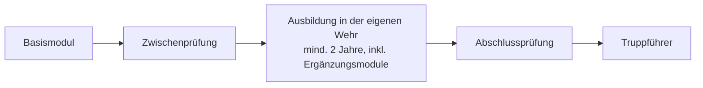

# Einführung & Orientierung

## Was ist die Modulare Truppausbildung (MTA)?

Die **Modulare Truppausbildung (MTA)** ist die standardisierte Grundausbildung für alle Feuerwehrangehörigen in Bayern. Sie ersetzt die frühere Truppmann-Ausbildung und ist **Voraussetzung** für alle weiterführenden Lehrgänge.

### Zweck der MTA

!!! quote "Ziel"
    Die MTA soll dich befähigen, **im Einsatz unter Anleitung** als Truppmann oder Truppfrau zu arbeiten. Du lernst die Grundlagen, um bei Bränden, technischen Hilfeleistungen und anderen Einsätzen sicher und effektiv zu helfen.

### Aufbau der MTA in Bayern



| Abschnitt | Inhalt | Abschluss |
|-----------|--------|-----------|
| **Basismodul** | Grundlagen in Theorie und Praxis, als Lehrgang auf Kreisebene. Das ist dein Kurs 2026/27. | **Zwischenprüfung** (Fragenkatalog Basismodul, 214 Fragen). Damit bist du **Truppmann**. |
| **Ausbildung in der Feuerwehr** | Übungsdienst in der eigenen Wehr über **mindestens 2 Jahre**, dazu **Ergänzungsmodule** | – |
| **Abschlussprüfung** | Wiederholung und Vertiefung | **Abschlussprüfung** (Fragenkatalog Truppführer, 60 Fragen, teilweise Multiple Choice). Damit bist du **Truppführer**. |

!!! info "Mindestalter (laut Lehrgangsausschreibung KFV Bayreuth)"
    - Start der MTA: **15 Jahre**
    - Zwischenprüfung: **16 Jahre**
    - Abschlussprüfung: **18 Jahre**

!!! info "Übergangsmodul"
    Wer die frühere Truppmannausbildung (Teil 1 + 2) schon abgelegt hat, braucht für die Truppführerqualifikation nur die im Ausbildungsplan **blau markierten Module**.

### Prüfungen

**Schriftliche Prüfung:**

- Multiple-Choice-Fragen
- Dauer: ca. 45-60 Minuten
- Themen: alle Module des Basismoduls

**Praktische Prüfung:**

- Knoten und Stiche
- Gerätehandhabung
- Löscheinsatz oder technische Hilfeleistung
- Arbeiten im Trupp

!!! question "Bestehensgrenze"
    Die genaue Bestehensgrenze und den Prüfungsablauf erfährst du am ersten Lehrgangsabend. Frag dort ausdrücklich danach. Für die Praxis gilt: Die Aufgaben müssen **sicher** beherrscht werden.

---

## Organisation der Freiwilligen Feuerwehr in Bayern

### Hierarchie und Struktur

Die Feuerwehr in Bayern ist hierarchisch organisiert:

```
Landesfeuerwehrverband Bayern (LFV)
    ↓
Bezirksfeuerwehrverband (BFV)
    ↓
Kreisfeuerwehrverband (KFV)
    ↓
Freiwillige Feuerwehr Goldkronach
    ↓
Gruppen / Züge
    ↓
Trupps (2 Personen)
```

### Ebenen im Detail

#### 1. Landesebene

- **Landesfeuerwehrverband Bayern (LFV)**
- Vertritt alle Feuerwehren in Bayern
- Erstellt Ausbildungsrichtlinien
- Organisiert Landeswettbewerbe

#### 2. Bezirksebene

- **Bezirksfeuerwehrverband (BFV)**
- Goldkronach gehört zum Bezirk Oberfranken
- Koordiniert größere Einsätze

#### 3. Kreisebene

- **Kreisfeuerwehrverband (KFV)**
- Goldkronach gehört zum Landkreis Bayreuth
- **Kreisbrandrat (KBR)**: oberster Feuerwehrmann im Landkreis
- **Kreisbrandinspektor (KBI)**: zuständig für einen Inspektionsbereich, z. B. die Inspektion I
- Organisiert MTA-Lehrgänge auf Kreisebene

#### 4. Gemeindeebene

- **Freiwillige Feuerwehr Goldkronach**
- Eigenständige Organisation
- Zuständig für Einsätze im Gemeindegebiet

### Rollen in der Feuerwehr

#### Kommandant

- **Leiter der Feuerwehr** vor Ort
- Verantwortlich für Ausbildung, Einsätze, Organisation
- Wird von den Mitgliedern gewählt

**Beispiel:** Der Kommandant plant den Übungsplan, bestellt neue Geräte und führt große Einsätze.

#### Stellvertretender Kommandant

- Unterstützt den Kommandant
- Vertritt ihn bei Abwesenheit

#### Gruppenführer

- Leitet eine Gruppe (1/8/9: Gruppenführer, Maschinist, Melder, Angriffs-, Wasser- und Schlauchtrupp)
- Kommandiert im Einsatz die Gruppe

**Beispiel:** Bei einem Wohnungsbrand teilt der Gruppenführer die Aufgaben ein: „Angriffstrupp zur Menschenrettung vor, Wassertrupp Wasserversorgung sicherstellen!"

#### Truppführer

- Leitet einen Trupp (2 Personen)
- Arbeitet eigenverantwortlich an Teilaufgaben

**Beispiel:** Der Truppführer des Angriffstrupps führt seinen Truppmann ins brennende Gebäude.

#### Truppmann / Truppfrau

- Unterstützt den Truppführer
- Führt Anweisungen aus
- **Das bist du nach der MTA!**

**Beispiel:** Der Truppmann trägt das Strahlrohr, während der Truppführer die Richtung vorgibt.

### Funktionen im Einsatz

#### Grundstruktur: Der Trupp
Ein **Trupp** besteht immer aus **2 Personen**:

- **Truppführer** (erfahrener)
- **Truppmann** (weniger erfahren)

!!! warning "Niemals allein!"
    In der Feuerwehr arbeitet man **niemals allein**. Der Trupp ist die kleinste Einheit und sichert sich gegenseitig ab.

#### Die Gruppe (1/8/9)

Eine **Gruppe** besteht aus:

1. **Gruppenführer** (1): erkundet, entscheidet, befiehlt
2. **Maschinist** (1): fährt das Fahrzeug, bedient die Pumpe
3. **Melder** (1): übermittelt Befehle und Rückmeldungen
4. **Angriffstrupp** (2): rettet, setzt den Verteiler, nimmt das 1. Rohr vor
5. **Wassertrupp** (2): stellt die Wasserversorgung zwischen Wasserentnahmestelle und Fahrzeug her
6. **Schlauchtrupp** (2): verlegt die B-Leitung vom Fahrzeug zum Verteiler, unterstützt mit Schlauchreserve

**Beispiel Einsatz Wohnungsbrand:**
```
Gruppenführer: "Wasserentnahmestelle Unterflurhydrant vor dem Haus,
                Verteiler neben den Hauseingang,
                Angriffstrupp zur Menschenrettung unter Atemschutz
                mit 1. C-Rohr in das 1. OG über den Treppenraum – vor!"
Angriffstrupp: setzt den Verteiler und geht mit C-Rohr ins Haus vor
Wassertrupp:   stellt die Wasserversorgung vom Hydranten zum Fahrzeug her
Schlauchtrupp: verlegt die B-Leitung zum Verteiler und bringt Schlauchreserve
```

Mehr dazu im Kapitel [Einheiten im Löscheinsatz](theorie/loescheinsatz.md).

---

## Typischer Ablauf der Ausbildung

### Phase 1: Theoretische Grundlagen (ca. 30-40 Stunden)

- Rechtsgrundlagen (FwG, UVV)
- Brennen und Löschen
- Fahrzeugkunde
- Gerätekunde
- Gefahren an der Einsatzstelle
- Verhalten im Einsatz

**Lernmethoden:**

- Präsentationen
- Videos
- Gruppenarbeiten
- Diskussionen

### Phase 2: Praktische Ausbildung (ca. 40-50 Stunden)

- Knoten und Stiche
- Leitern
- Schläuche kuppeln und verlegen
- Löschübungen (mit Wasser, ggf. mit Feuer)
- Technische Hilfeleistung (Absichern, Retten, Heben)
- Atemschutz-Gewöhnung
- Funk

**Lernmethoden:**

- Stationsausbildung
- Übungen in Kleingruppen
- Reale Szenarien
- Wiederholung, Wiederholung, Wiederholung

### Phase 3: Prüfungsvorbereitung

- Zusammenfassung der Theorie
- Wiederholung Knoten
- Probeprüfungen

### Phase 4: Prüfung

- Schriftlich (Multiple Choice)
- Praktisch (Stationen)

### Phase 5: Ausbildung in der Feuerwehr (mind. 2 Jahre) bis zur Abschlussprüfung

- Teilnahme am regulären Übungsdienst
- Vertiefung der Kenntnisse
- Einsatznachbesprechungen
- Spezialisierungen (z. B. Atemschutz, Maschinist)

---

## Unterschied Theorie ↔ Praxis

### Theorie

**Ziel:** Verstehen, **warum** wir etwas tun

**Inhalte:**

- Wie funktioniert Verbrennung?
- Welche Löschmittel gibt es?
- Welche Gesetze regeln die Feuerwehr?
- Wie funktioniert ein Feuerlöscher?

**Lernort:** Klassenzimmer, Schulungsraum

**Prüfung:** Schriftlicher Test

!!! tip "Lerntipp"
    Theorie ist die Basis für sicheres Handeln im Einsatz. Wer versteht, warum etwas gemacht wird, macht es richtig.

### Praxis

**Ziel:** Können, **wie** wir etwas tun

**Inhalte:**

- Knoten binden
- Schläuche kuppeln
- Leitern aufstellen
- Löschübungen durchführen

**Lernort:** Feuerwehrhaus, Übungsgelände, Straße

**Prüfung:** Praktische Stationen

!!! tip "Übungstipp"
    Praxis braucht Wiederholung! Knoten, die du 100-mal gemacht hast, kannst du auch unter Stress.

---

## Beförderungen & Dienstgrade

Nach der MTA kannst du dich weiterbilden, z. B. als Atemschutzgeräteträger, Maschinist oder später Gruppenführer.

!!! question "Dienstgrade in Bayern"
    Welche Dienstgrade es gibt und welche Voraussetzungen jeweils gelten, ist in Bayern landesrechtlich geregelt. Ernannt werden sie vom **Kommandanten**.
    Die genauen Voraussetzungen, also Dienstjahre und Lehrgänge, erfragst du am besten direkt bei deinem Kommandanten. Wir führen hier bewusst keine Tabelle, solange sie nicht gegen die aktuelle Regelung geprüft ist.

!!! info "Wichtig"
    Dienstgrade sind **keine Ränge wie beim Militär**, sondern zeigen Erfahrung und Ausbildung. Respekt verdient man sich durch Können, nicht durch Schulterklappen.

---

## Wichtige Prinzipien der Feuerwehr

### 1. Sicherheit geht vor

!!! danger "Oberste Regel"
    **Eigenschutz vor Fremdschutz!** Du kannst niemandem helfen, wenn du selbst verletzt bist.

### 2. Kameradschaft

Die Feuerwehr funktioniert nur, wenn alle zusammenarbeiten und sich gegenseitig helfen.

### 3. Freiwilligkeit

In Bayern sind die meisten Feuerwehren freiwillig. Das bedeutet: Du machst das ehrenamtlich, in deiner Freizeit – aus Überzeugung.

### 4. Politische & religiöse Neutralität

Die Feuerwehr hilft **allen Menschen**, unabhängig von Herkunft, Religion oder politischer Einstellung.

---

## Erwartungen an dich

### Während der MTA

- **Pünktlichkeit**: Sei immer 10 Minuten früher da
- **Mitarbeit**: Stelle Fragen, mach mit, lerne aktiv
- **Respekt**: Gegenüber Ausbildern und Kameraden
- **Eigeninitiative**: Übe zuhause (Knoten!), lies nach

### Nach der MTA

- **Übungsdienst**: Nimm regelmäßig teil (1-2x pro Monat)
- **Einsätze**: Rücke aus, wenn du alarmiert wirst
- **Weiterbildung**: Besuche weitere Lehrgänge
- **Kameradschaft**: Engagiere dich, hilf mit, pflege das Gemeinschaftsleben

---

## Nächste Schritte

Jetzt weißt du, was die MTA ist und wie die Feuerwehr organisiert ist. Weiter geht's mit:

1. [Begriffe & Abkürzungen](begriffe.md) – damit du die Feuerwehrsprache verstehst
2. [Theorie: Ziele & Aufgaben](theorie/ziele-aufgaben.md) – die Grundlagen der Feuerwehr
