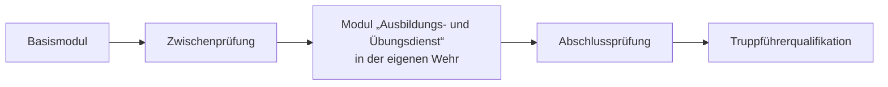

# Einführung & Orientierung

!!! abstract "Quelle"
    Teilnehmer- und Ausbilderunterlage MTA 2.1 „Rechtsgrundlagen und Organisation“, Teilnehmerunterlage MTA 2.2 „Rechte und Pflichten“, Fachinformation „Teilnahme von Feuerwehranwärtern vom vollendeten 16. bis zum vollendeten 18. Lebensjahr an Einsätzen der Feuerwehr“, Teilnehmerunterlage MTA 7.1 „Verhalten im Einsatz und in der Öffentlichkeit“, Ausbilderunterlage MTA 5.2 „Spezielle persönliche Schutzausrüstung“, Teilnehmerunterlage MTA 9.5 „Einheiten im Löscheinsatz – Theorie“, Präsentation MTA 8 „Verhalten bei Gefahr“, Prüfungsunterlagen MTA 15.4 „Zwischenprüfung“ (alle SFS Würzburg); Bayerisches Feuerwehrgesetz (BayFwG); Ausbildungsplan Inspektion I Landkreis Bayreuth 2026/27; [Lehrgangsinfo MTA des KFV Bayreuth](https://kfv-bayreuth-lehrgaenge.de/lehrgangsinfo.php?lehrgang=LGT-6a6af544-cdf2-4432-a3f3-fd2a8f1b8a11) (Mindestalter); dazu der offizielle Fragenkatalog.
    Ergänzend zur Dauer des Ausbildungs- und Übungsdienstes und zu Folgelehrgängen: [MTA – Informationen zur Durchführung im Landkreis Landshut (2019)](https://adlkofen.feuerwehren.bayern/media/filer_public/a0/bd/a0bd6d50-47b4-48fa-990a-f535e424cb4c/mta_informationen_zur_durchfuhrung_2019.pdf) · [Anmeldevoraussetzungen MTA, Landkreis Weißenburg-Gunzenhausen (2023)](https://kfv-wug.feuerwehren.bayern/media/filer_public/c6/9e/c69ebb8e-8152-4eb1-a241-81078aa3e369/2023_02_01_anmeldevorausetzugnen_mta.pdf)
    Alle Unterlagen: [Feuerwehr-Lernbar – Rechtsgrundlagen und Organisation](https://www.feuerwehr-lernbar.bayern/post/rechtsgrundlagen-und-organisation) · [Feuerwehr-Lernbar – Löscheinsatz](https://www.feuerwehr-lernbar.bayern/post/mta-loscheinsatz) · [Feuerwehr-Lernbar – Zwischenprüfung](https://www.feuerwehr-lernbar.bayern/post/mta-zwischenpruefung)

## Was ist die Modulare Truppausbildung (MTA)?

Die **Modulare Truppausbildung (MTA)** ist die Ausbildung für Feuerwehrdienstleistende in Bayern. Ihr **Basismodul** ist die **feuerwehrtechnische Grundausbildung**. Es beinhaltet auch die **Funkausbildung** und die **Erste-Hilfe-Ausbildung**.

Die MTA ist **Voraussetzung für weiterführende Lehrgänge**, z. B. Atemschutzgeräteträger oder Maschinist. Welche Module jeweils abgeschlossen sein müssen (Basismodul oder komplette MTA), steht in der Lehrgangsausschreibung.

### Zweck der MTA

!!! quote "Ziel"
    In der MTA lernst du die Aufgaben im **Trupp**: Truppmann und Truppführer bilden zusammen einen Trupp. Ziel am Ende der gesamten Ausbildung ist die **Truppführerqualifikation**.

!!! info "Warum das Basismodul so wichtig ist"
    Feuerwehranwärter dürfen ab **16 Jahren** an Einsätzen teilnehmen, wenn das **Basismodul abgeschlossen** ist und der **Kommandant zustimmt** – und auch dann nur außerhalb des unmittelbaren Gefahrenbereichs (mehr unter [Mindestalter](#aufbau-der-mta-in-bayern)).

### Aufbau der MTA in Bayern



| Abschnitt | Inhalt | Abschluss |
|-----------|--------|-----------|
| **Basismodul** | Grundlagen in Theorie und Praxis, als Lehrgang auf Kreisebene (Themen 1.0–15, siehe [MTA-Module](mta-module.md)). Das ist dein Kurs 2026/27. | **Zwischenprüfung** (Fragenkatalog Basismodul, 214 Fragen). Das Zwischenzeugnis berechtigt zur Teilnahme am Modul **„Ausbildungs- und Übungsdienst“**. |
| **Ausbildungs- und Übungsdienst** | Ausbildung im Übungsdienst der eigenen Wehr, in der Regel über **etwa zwei Jahre** (Landkreis-Unterlagen nennen z. B. 40 Ausbildungsstunden, die der Kommandant bestätigt) | – |
| **Abschlussprüfung** | Wiederholung und Vertiefung, Blick aus Sicht des **Truppführers** | **Abschlussprüfung** (Fragenkatalog Truppführer, 60 Fragen; bei einem Teil der Fragen sind mehrere Antworten richtig). |

!!! info "Mindestalter und Altersgrenzen"
    - Laut Lehrgangsinfo des KFV Bayreuth: Start der MTA **15 Jahre**, Zwischenprüfung **16 Jahre**, Abschlussprüfung **18 Jahre**
    - Feuerwehranwärter: vom vollendeten **12.** bis zum vollendeten **18. Lebensjahr** (Art. 7 BayFwG)
    - Einsätze als Anwärter: erst ab dem vollendeten **16. Lebensjahr**, nur **außerhalb der unmittelbaren Gefahrenzone**, Basismodul abgeschlossen, Kommandant muss zustimmen
    - Feuerwehrdienst als Erwachsener: ab dem vollendeten **18. Lebensjahr** (Art. 6 BayFwG)

!!! info "Übergangsmodul"
    Wer die frühere Truppmannausbildung (Teil 1 + 2) schon abgelegt hat, braucht für die Truppführerqualifikation nur die im Ausbildungsplan **blau markierten Module**.

### Zwischenprüfung

Laut Prüfungsnachweis der Staatlichen Feuerwehrschule Würzburg besteht sie aus:

- **Schriftlicher Teil:** Fragebogen → üben mit den [Prüfungsfragen](pruefung/fragen.md)
- **Drei praktische Aufgaben** aus einem festen Aufgabenpool (z. B. bewusstlose Person, Strahlrohr, Feuerlöscher, Brustbund, Hydrant, Knoten, Schlauchbrücke)
- **Eine Sprechfunk-Aufgabe** (Hand- oder Fahrzeugfunkgerät)

Alle Aufgaben mit Bewertungskriterien: **[MTA-Module → Zwischenprüfung](mta-module.md#zwischenprufung)**

!!! question "Bestehensgrenze"
    Die genaue Bestehensgrenze und den Prüfungsablauf erfährst du am ersten Lehrgangsabend. Frag dort ausdrücklich danach. Für die Praxis gilt: Die Aufgaben müssen **sicher** beherrscht werden.

---

## Organisation der Freiwilligen Feuerwehr in Bayern

### Hierarchie und Struktur

Abwehrender Brandschutz und technischer Hilfsdienst sind eine **Pflichtaufgabe der Gemeinde**. Dazu muss die Gemeinde Feuerwehren **aufstellen, ausrüsten und unterhalten**.

```
Staat (Landrat / Landratsamt)
    ↓
Kreisbrandrat (KBR)
    ↓
Kreisbrandinspektor (KBI) – Inspektionsbereich
    ↓
Kreisbrandmeister (KBM)

Gemeinde → Freiwillige Feuerwehr Goldkronach
    ↓
Kommandant
    ↓
Züge (nur bei größeren Wehren) / Gruppen / Staffeln
    ↓
Trupps (Truppführer + Truppmann)
```

Die **Feuerwehrverbände** (Kreis-, Bezirks- und Landesfeuerwehrverband) stehen **nicht** in dieser Befehlskette. Sie sind Interessenvertretungen der Feuerwehren.

**Arten der Feuerwehren:** Freiwillige Feuerwehr, Pflichtfeuerwehr, Berufsfeuerwehr, Werkfeuerwehr und sonstige Feuerwehren (z. B. Betriebsfeuerwehren).

### Ebenen im Detail

#### 1. Landesebene

- Der **Staat** fördert den Brandschutz und den technischen Hilfsdienst und unterhält die **Landesfeuerwehrschulen** (z. B. die Staatliche Feuerwehrschule Würzburg, von der die MTA-Unterlagen stammen).
- Der **Landesfeuerwehrverband Bayern (LFV)** ist eine Interessenvertretung der Feuerwehren. Das Staatsministerium arbeitet mit ihm zusammen.

#### 2. Bezirksebene

- **Bezirksfeuerwehrverband (BFV)**
- Goldkronach gehört zum Bezirk Oberfranken

#### 3. Kreisebene

- Goldkronach gehört zum Landkreis Bayreuth
- **Kreisbrandrat (KBR)**: höchster Feuerwehrler im Landkreis. Er wird von den Kommandanten der Freiwilligen Feuerwehren und den Leitern der Werkfeuerwehren auf sechs Jahre gewählt. Er berät und unterstützt Landratsamt, Gemeinden und Feuerwehren, besichtigt die Feuerwehren und sorgt für die Ausbildungsveranstaltungen.
- **Kreisbrandinspektor (KBI)**: steht einem Kreisbrandinspektionsbereich vor (z. B. die Inspektion I) und untersteht dem KBR
- **Kreisbrandmeister (KBM)**: untersteht dem KBI (bei Aufgaben für den ganzen Landkreis direkt dem KBR), betreut seine Feuerwehren und spezielle Aufgabengebiete
- KBI und KBM werden vom KBR **bestellt**. KBR, KBI und KBM sind ehrenamtlich **für den Staat** tätig und unterstehen dem **Landrat**.
- **Kreisfeuerwehrverband (KFV)**: Über ihn läuft im Landkreis Bayreuth die Anmeldung zu den Lehrgängen ([kfv-bayreuth-lehrgaenge.de](https://kfv-bayreuth-lehrgaenge.de/)).

#### 4. Gemeindeebene

- **Freiwillige Feuerwehr Goldkronach**
- Die gemeindliche Feuerwehr ist eine **öffentliche Einrichtung der Gemeinde**
- Der **Feuerwehrverein** unterstützt die gemeindliche Einrichtung Feuerwehr personell. Die Mitgliedschaft im Verein ist getrennt von der Aufnahme in die Feuerwehr: In die Feuerwehr nimmt dich der **Kommandant** auf, für den Verein stellst du einen eigenen Aufnahmeantrag.

### Rollen in der Feuerwehr

#### Kommandant

- Wird von den Feuerwehrdienstleistenden und den Feuerwehranwärtern ab 16 Jahren in **geheimer Wahl auf sechs Jahre** gewählt; die Gemeinde muss die Wahl im Benehmen mit dem Kreisbrandrat bestätigen
- Sorgt für die **Einsatzbereitschaft**, leitet die **Einsätze** und die **Ausbildung**
- **Ernennt** die Mannschafts- und Führungsdienstgrade und **nimmt** neue Feuerwehrdienstleistende und Anwärter **auf**
- Berät die Gemeinde in Fragen des Brandschutzes und des technischen Hilfsdienstes

**Beispiel:** Wenn du verhindert bist, entschuldigst du dich beim Kommandanten oder beim nächsten Vorgesetzten.

#### Stellvertretender Kommandant

- Wird wie der Kommandant gewählt
- Vertritt den Kommandanten

#### Zugführer

- Wird vom Kommandanten bestellt, nur bei größeren Freiwilligen Feuerwehren
- Führt den Zug bei Einsatz, Ausbildung und Übungen

#### Gruppenführer

- Wird vom Kommandanten bestellt
- Führt die zugeteilte Gruppe bei Einsatz, Ausbildung, Übungen und sonstigen Tätigkeiten
- Hat die Einsatzleitung, wenn nur Gruppenführer anwesend sind

#### Truppführer

- Bildet mit dem Truppmann einen **Trupp**
- Der Trupp handelt im Rahmen seines Auftrags **selbstständig und eigenverantwortlich**; der Truppführer ist für die **Sicherheit des Trupps** und die Erledigung des Auftrags verantwortlich
- Trifft die Entscheidungen im Trupp, z. B. welcher Bereich zuerst abgesucht wird, wenn der Befehl dazu nichts sagt

**Beispiel:** Der Truppführer bestimmt, ob der Trupp mit Vollstrahl oder Sprühstrahl löscht.

#### Truppmann / Truppfrau

- Bildet mit dem Truppführer einen Trupp
- Führt die vom Vorgesetzten angeordneten Tätigkeiten aus

**Beispiel:** Legt der Truppmann die Schläuche falsch aus, muss ihn der Truppführer darauf hinweisen und überwachen, dass er die Hinweise beachtet.

### Funktionen im Einsatz

#### Grundstruktur: Der Trupp
Ein **Trupp** besteht aus:

- **Truppführer**
- **Truppmann**

!!! warning "Truppweise arbeiten!"
    Der Trupp bleibt **stets zusammen** und geht **truppweise geschlossen** vor.

#### Taktische Einheiten

- **Selbstständiger Trupp**
- **Staffel** (1/5/6): Einheitsführer, Maschinist, Angriffstrupp, Wassertrupp
- **Gruppe** (1/8/9): die **taktische Grundeinheit** der Feuerwehr
- **Zug**

#### Die Gruppe (1/8/9)

Eine **Gruppe** besteht aus:

1. **Gruppenführer** (1): führt die Gruppe, ist für die Sicherheit der Mannschaft verantwortlich, bestimmt die Fahrzeugaufstellung, ist an keinen bestimmten Platz gebunden
2. **Maschinist** (1): ist Fahrer, bedient Pumpe und Aggregate, sichert sofort die Einsatzstelle (Warnblinkanlage, Fahrlicht, Blaulicht)
3. **Melder** (1): übernimmt befohlene Aufgaben (z. B. Informationsübertragung, Betreuung, Erkundung)
4. **Angriffstrupp** (2): rettet, setzt den Verteiler, nimmt in der Regel das erste Rohr vor und verlegt seine Schlauchleitung selbst
5. **Wassertrupp** (2): rettet, stellt die Wasserversorgung zwischen Wasserentnahmestelle und Fahrzeug sowie vom Fahrzeug zum Verteiler her, kuppelt den Verteiler an die B-Leitung an, wird beim Atemschutzeinsatz Sicherheitstrupp
6. **Schlauchtrupp** (2): rettet, unterstützt die vorgehenden Trupps beim Verlegen der Schlauchleitung vom Verteiler zur Einsatzstelle, führt auf Befehl weitere Tätigkeiten aus

Fehlen Einsatzkräfte, bestimmt der Einheitsführer, wer welche Aufgaben übernimmt.

**Beispiel Einsatz Wohnungsbrand:**
```
Gruppenführer: "Wasserentnahmestelle Unterflurhydrant vor dem Haus,
                Verteiler neben den Hauseingang,
                Angriffstrupp zur Menschenrettung unter Atemschutz
                mit 1. C-Rohr in das 1. OG über den Treppenraum – vor!"
Angriffstrupp: wiederholt den Befehl, setzt den Verteiler und geht mit C-Rohr vor
Wassertrupp:   stellt die Wasserversorgung vom Hydranten zum Fahrzeug
               und die B-Leitung vom Fahrzeug zum Verteiler her
Schlauchtrupp: unterstützt den Angriffstrupp beim Verlegen der C-Leitung
```

Mehr dazu im Kapitel [Einheiten im Löscheinsatz](theorie/loescheinsatz.md).

---

## Typischer Ablauf der Ausbildung

1. **Basismodul** (Lehrgang auf Kreisebene): Themen 1.0 bis 15, Theorie und Praxis. Die einzelnen Themen findest du unter [MTA-Module](mta-module.md).
2. **Erste Hilfe:** Für die feuerwehrspezifische Erste Hilfe brauchst du vorher einen **Erste-Hilfe-Grundlehrgang**. Die Bescheinigung wird bei Thema 5.12 kontrolliert und darf **nicht älter als 5 Jahre** sein.
3. **Zwischenprüfung:** schriftlicher Fragebogen, drei praktische Aufgaben und eine Sprechfunk-Aufgabe (siehe oben).
4. **Modul „Ausbildungs- und Übungsdienst“** in der eigenen Wehr, in der Regel über etwa zwei Jahre. Für manche spezielle Schutzausrüstung sind zusätzlich **Ergänzungsmodule bzw. Lehrgänge** erforderlich.
5. **Abschlussprüfung** mit dem Fragenkatalog Truppführer.

!!! tip "Frag nach"
    Wie lange der Ausbildungs- und Übungsdienst in deiner Wehr dauert und wann die Abschlussprüfung ansteht, erfährst du von deinem Kommandanten bzw. deinen Ausbildern.

---

## Unterschied Theorie ↔ Praxis

### Theorie

**Ziel:** Verstehen, **warum** wir etwas tun

**Inhalte (Beispiele):**

- Wie funktioniert Verbrennung?
- Welche Löschmittel gibt es?
- Welche Gesetze regeln die Feuerwehr?
- Wie funktioniert ein Feuerlöscher?

**Prüfung:** schriftlicher Teil der Zwischenprüfung

!!! tip "Lerntipp"
    Wer versteht, warum etwas gemacht wird, kann es sich leichter merken.

### Praxis

**Ziel:** Können, **wie** wir etwas tun

**Inhalte (Beispiele):**

- Knoten binden
- Schläuche kuppeln
- Leitern aufstellen
- Feuerlöscher einsetzen

**Prüfung:** praktische Aufgaben und Sprechfunk-Aufgabe der Zwischenprüfung

!!! tip "Übungstipp"
    Praxis braucht Wiederholung! Übe vor allem die Knoten immer wieder.

---

## Beförderungen & Dienstgrade

**Ernannt** werden die Dienstgrade vom **Kommandanten**. Wie viele Dienstgrade es in einer Feuerwehr gibt, richtet sich nach ihrer Stärke.

Dienstgrade bei den Freiwilligen Feuerwehren (in dieser Reihenfolge):

| Gruppe | Dienstgrad |
|--------|------------|
| – | Feuerwehranwärter/-in |
| Mannschaftsdienstgrade | Feuerwehrmann/-frau · Oberfeuerwehrmann/-frau · Hauptfeuerwehrmann/-frau |
| Führungsdienstgrade | Löschmeister/-in · Oberlöschmeister/-in · Hauptlöschmeister/-in · Brandmeister/-in · Oberbrandmeister/-in · Hauptbrandmeister/-in |

- **Dienstgradabzeichen:** schwarzes Stoffabzeichen mit roter Umrandung und roten oder silberfarbenen Balken, getragen am linken Oberärmel von Dienstrock und Dienstmantel
- Führungsdienstgraden wird meistens zugleich eine **Funktion** übertragen, z. B. Gruppenführer oder Zugführer (bzw. deren Stellvertreter).
- **Kommandant**, **stellvertretender Kommandant**, **Verbandsführer**, **Zugführer** und **Gruppenführer** sind **Führungsfunktionen**, keine Dienstgrade. Der Kommandant trägt als Funktionsabzeichen einen schmalen goldenen Balken am Ärmel und einen senkrechten roten Balken vorne am Helm.

!!! question "Voraussetzungen für Beförderungen"
    Welche Dienstjahre und Lehrgänge für den nächsten Dienstgrad nötig sind, erfragst du direkt bei deinem Kommandanten.

---

## Wichtige Prinzipien der Feuerwehr

### 1. Sicherheit geht vor

!!! danger "Oberste Regel"
    **Sicherheit und Eigenschutz gehen auch im Feuerwehreinsatz stets vor!** Ein verletzter oder toter Helfer kann nicht mehr helfen.

### 2. Truppweise arbeiten

Der Trupp bleibt stets zusammen, sichert den Rückzugsweg und meldet erkannte Gefahren sofort.

### 3. Ehrenamt

Feuerwehr ist eine **Pflichtaufgabe der Gemeinde**. Der Feuerwehrdienst wird – soweit nichts anderes bestimmt ist – **ehrenamtlich** geleistet.

### 4. Verhalten in der Öffentlichkeit

Jeder Feuerwehrdienstleistende ist ein **Spiegelbild seiner Organisation** in der Öffentlichkeit. Korrektes und höfliches Verhalten gegenüber Bürgern an der Einsatzstelle sollte selbstverständlich sein.

---

## Erwartungen an dich

### Während der MTA

- **Pünktlichkeit**: Sei rechtzeitig da
- **Mitarbeit**: Stelle Fragen, mach mit, lerne aktiv
- **Respekt**: Gegenüber Ausbildern und Kameraden
- **Eigeninitiative**: Übe zuhause (Knoten!), lies nach

### Pflichten im Feuerwehrdienst

- **Teilnahme**: Feuerwehrdienstleistende haben an Einsätzen, Ausbildungsveranstaltungen, Sicherheitswachen und am Bereitschaftsdienst teilzunehmen
- **Weisungen**: Die Weisungen der Vorgesetzten sind zu befolgen; Einsatzbefehle werden ausgeführt, nicht „ausdiskutiert“
- **Dienstverhinderung**: Kannst du aus dringenden Gründen oder wegen Krankheit nicht kommen, entschuldige dich beim Kommandanten oder beim nächsten Vorgesetzten
- **Dienst- und Schutzkleidung**: im Dienst tragen und bei Bedarf reinigen und instand halten

---

## Nächste Schritte

Jetzt weißt du, was die MTA ist und wie die Feuerwehr organisiert ist. Weiter geht's mit:

1. [Begriffe & Abkürzungen](begriffe.md) – damit du die Feuerwehrsprache verstehst
2. [Theorie: Ziele & Aufgaben](theorie/ziele-aufgaben.md) – die Grundlagen der Feuerwehr
