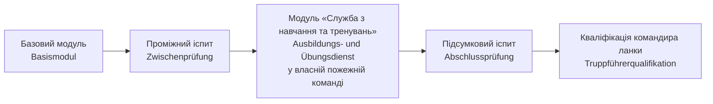

# Вступ і орієнтація {#einfuhrung-orientierung}

!!! abstract "Джерело"
    Матеріали для учасників і викладачів MTA 2.1 „Rechtsgrundlagen und Organisation“ (Правові основи та організація), матеріали для учасників MTA 2.2 „Rechte und Pflichten“ (Права та обов'язки), фахова інформація „Teilnahme von Feuerwehranwärtern vom vollendeten 16. bis zum vollendeten 18. Lebensjahr an Einsätzen der Feuerwehr“ (Участь кандидатів у пожежники віком від 16 до 18 років у виїздах пожежної команди), матеріали для учасників MTA 7.1 „Verhalten im Einsatz und in der Öffentlichkeit“ (Поведінка на виклику та на публіці), матеріали для викладачів MTA 5.2 „Spezielle persönliche Schutzausrüstung“ (Спеціальні засоби індивідуального захисту), матеріали для учасників MTA 9.5 „Einheiten im Löscheinsatz – Theorie“ (Підрозділи під час гасіння – теорія), презентація MTA 8 „Verhalten bei Gefahr“ (Поведінка в разі небезпеки), екзаменаційні матеріали MTA 15.3 „Zwischenprüfung – Praktischer Teil“ (Проміжний іспит – практична частина) і 15.4 „Nachweis über die Zwischenprüfung“ (Протокол проміжного іспиту) (усі – SFS Würzburg); Bayerisches Feuerwehrgesetz (BayFwG); Ausbildungsplan Inspektion I Landkreis Bayreuth 2026/27; [Lehrgangsinfo MTA des KFV Bayreuth (німецькою)](https://kfv-bayreuth-lehrgaenge.de/lehrgangsinfo.php?lehrgang=LGT-6a6af544-cdf2-4432-a3f3-fd2a8f1b8a11) (мінімальний вік); а також офіційний каталог питань (Fragenkatalog).
    Додатково щодо тривалості служби з навчання та тренувань і щодо подальших курсів: [MTA – Informationen zur Durchführung im Landkreis Landshut (2019) (німецькою)](https://adlkofen.feuerwehren.bayern/media/filer_public/a0/bd/a0bd6d50-47b4-48fa-990a-f535e424cb4c/mta_informationen_zur_durchfuhrung_2019.pdf) · [Anmeldevoraussetzungen MTA, Landkreis Weißenburg-Gunzenhausen (2023) (німецькою)](https://kfv-wug.feuerwehren.bayern/media/filer_public/c6/9e/c69ebb8e-8152-4eb1-a241-81078aa3e369/2023_02_01_anmeldevorausetzugnen_mta.pdf)
    Усі матеріали: [Feuerwehr-Lernbar – Rechtsgrundlagen und Organisation (німецькою)](https://www.feuerwehr-lernbar.bayern/post/rechtsgrundlagen-und-organisation) · [Feuerwehr-Lernbar – Löscheinsatz (німецькою)](https://www.feuerwehr-lernbar.bayern/post/mta-loscheinsatz) · [Feuerwehr-Lernbar – Zwischenprüfung (німецькою)](https://www.feuerwehr-lernbar.bayern/post/mta-zwischenpruefung)

## Що таке модульна підготовка ланки (MTA)? {#was-ist-die-modulare-truppausbildung-mta}

**Модульна підготовка ланки (Modulare Truppausbildung, MTA)** – це навчання для пожежників (Feuerwehrdienstleistende) у Баварії. Її **базовий модуль** (Basismodul) – це **базова пожежно-технічна підготовка** (feuerwehrtechnische Grundausbildung). Він також охоплює **навчання радіозв'язку** (Funkausbildung) і **навчання першої допомоги** (Erste-Hilfe-Ausbildung).

MTA є **передумовою для подальших курсів** (weiterführende Lehrgänge), напр. для носія дихального апарата (Atemschutzgeräteträger) або водія-моториста (Maschinist). Які саме модулі мають бути завершені (базовий модуль чи вся MTA), зазначено в оголошенні про курс (Lehrgangsausschreibung).

### Мета MTA {#zweck-der-mta}

!!! quote "Мета"
    У MTA ти вивчаєш завдання в **ланці** (Trupp): член ланки (Truppmann) і командир ланки (Truppführer) разом утворюють ланку. Мета наприкінці всього навчання – **кваліфікація командира ланки** (Truppführerqualifikation).

!!! info "Чому базовий модуль такий важливий"
    Кандидати в пожежники (Feuerwehranwärter) можуть брати участь у виїздах із **16 років**, якщо **базовий модуль завершено** і **командир (Kommandant) погоджується** – і навіть тоді лише поза безпосередньою зоною небезпеки (докладніше в розділі [Мінімальний вік](#aufbau-der-mta-in-bayern)).

### Структура MTA в Баварії {#aufbau-der-mta-in-bayern}



| Етап | Зміст | Завершення |
|------|-------|------------|
| **Базовий модуль** (Basismodul) | Основи теорії та практики, курс на рівні району (теми 1.0–15, див. [Модулі MTA](mta-module.md)). Це твій курс 2026/27. | **Проміжний іспит** (Zwischenprüfung; письмово 50 питань із каталогу питань базового модуля, а також практичні завдання і завдання з радіозв'язку). Проміжне свідоцтво (Zwischenzeugnis) дає право брати участь у модулі **«Служба з навчання та тренувань»** (Ausbildungs- und Übungsdienst). |
| **Служба з навчання та тренувань** (Ausbildungs- und Übungsdienst) | Навчання під час тренувань у власній пожежній команді, як правило, протягом **приблизно двох років** (матеріали районів називають, напр., 40 навчальних годин, які підтверджує командир) | – |
| **Підсумковий іспит** (Abschlussprüfung) | Повторення і поглиблення, погляд з позиції **командира ланки** | **Підсумковий іспит**: письмово 15 питань із каталогу питань для командира ланки (Fragenkatalog Truppführer; у частині питань кілька правильних відповідей), а також завдання ланки (Truppaufgabe) і завдання відділення або групи (Staffel- oder Gruppenaufgabe) у ролі командира ланки. Умови: 18 років і завершений модуль «Служба з навчання та тренувань» ([докладно](mta-module.md#abschlussprufung)). |

!!! info "Мінімальний вік і вікові межі"
    - За інформацією про курс від KFV Bayreuth: початок MTA – **15 років**, проміжний іспит – **16 років**, підсумковий іспит – **18 років**
    - Кандидати в пожежники (Feuerwehranwärter): від повних **12** до повних **18 років** (Art. 7 BayFwG)
    - Виїзди як кандидат: лише з повних **16 років**, лише **поза безпосередньою зоною небезпеки**, базовий модуль завершено, командир має погодитися
    - Служба в пожежній команді як дорослий: з повних **18 років** (Art. 6 BayFwG)

!!! info "Перехідний модуль (Übergangsmodul)"
    Хто вже склав колишню підготовку члена ланки (Truppmannausbildung, частини 1 + 2), тому для кваліфікації командира ланки потрібні лише **модулі, позначені синім** у навчальному плані (Ausbildungsplan).

### Проміжний іспит {#zwischenprufung}

Згідно з екзаменаційним протоколом Державної пожежної школи Вюрцбурга (Staatliche Feuerwehrschule Würzburg) він складається з:

- **Письмова частина:** анкета з питаннями → тренуйся з [екзаменаційними питаннями](pruefung/fragen.md)
- **Три практичні завдання** з фіксованого переліку (напр. людина без свідомості, пожежний ствол, вогнегасник, грудна обв'язка (Brustbund), гідрант, вузли, рукавний місток (Schlauchbrücke))
- **Одне завдання з радіозв'язку** (Sprechfunk; ручна або автомобільна радіостанція)

Усі завдання з критеріями оцінювання: **[Модулі MTA → Проміжний іспит](mta-module.md#zwischenprufung)**

!!! question "Прохідний бал (Bestehensgrenze)"
    Точний прохідний бал і порядок іспиту ти дізнаєшся на першому вечорі курсу. Обов'язково спитай про це там. Для практики діє правило: завдання треба виконувати **впевнено**.

---

## Організація добровільної пожежної команди в Баварії {#organisation-der-freiwilligen-feuerwehr-in-bayern}

### Ієрархія та структура {#hierarchie-und-struktur}

Протипожежний захист (abwehrender Brandschutz) і технічна допомога (technischer Hilfsdienst) – це **обов'язкове завдання громади** (Pflichtaufgabe der Gemeinde). Для цього громада має **створювати, оснащувати й утримувати** пожежні команди.

```
Держава (Landrat / Landratsamt – голова району / районна адміністрація)
    ↓
Kreisbrandrat (KBR)
    ↓
Kreisbrandinspektor (KBI) – інспекційний округ
    ↓
Kreisbrandmeister (KBM)

Громада (Gemeinde) → добровільна пожежна команда Goldkronach
    ↓
Командир (Kommandant)
    ↓
Взводи (Züge, лише у великих командах) / відділення (Gruppen) / розрахунки (Staffeln)
    ↓
Ланки (Trupps: командир ланки + член ланки)
```

**Пожежні спілки** (Feuerwehrverbände: районна, окружна та земельна) **не** входять до цього ланцюга командування. Вони представляють інтереси пожежних команд.

**Види пожежних команд:** добровільна пожежна команда (Freiwillige Feuerwehr), обов'язкова пожежна команда (Pflichtfeuerwehr), професійна пожежна охорона (Berufsfeuerwehr), заводська пожежна команда (Werkfeuerwehr) та інші пожежні команди (напр. Betriebsfeuerwehren – пожежні команди підприємств).

### Рівні докладно {#ebenen-im-detail}

#### 1. Рівень землі (Landesebene) {#1-landesebene}

- **Держава** підтримує протипожежний захист і технічну допомогу та утримує **земельні пожежні школи** (Landesfeuerwehrschulen; напр. Державну пожежну школу Вюрцбурга – Staatliche Feuerwehrschule Würzburg, від якої походять матеріали MTA).
- **Landesfeuerwehrverband Bayern (LFV)** – земельна пожежна спілка Баварії – представляє інтереси пожежних команд. Державне міністерство співпрацює з нею.

#### 2. Рівень округу (Bezirksebene) {#2-bezirksebene}

- **Bezirksfeuerwehrverband (BFV)** – окружна пожежна спілка
- Goldkronach належить до округу (Bezirk) Oberfranken

#### 3. Рівень району (Kreisebene) {#3-kreisebene}

- Goldkronach належить до району (Landkreis) Bayreuth
- **Kreisbrandrat (KBR)**: найвищий пожежник у районі. Його обирають командири добровільних пожежних команд і керівники заводських пожежних команд на шість років. Він консультує та підтримує районну адміністрацію (Landratsamt), громади та пожежні команди, інспектує пожежні команди й організовує навчальні заходи.
- **Kreisbrandinspektor (KBI)**: очолює інспекційний округ (Kreisbrandinspektionsbereich; напр. Inspektion I) і підпорядковується KBR
- **Kreisbrandmeister (KBM)**: підпорядковується KBI (у завданнях для всього району – безпосередньо KBR), опікується своїми пожежними командами та спеціальними напрямами роботи
- KBI і KBM **призначає** KBR. KBR, KBI і KBM працюють на громадських засадах **для держави** і підпорядковуються **голові району** (Landrat).
- **Kreisfeuerwehrverband (KFV)** – районна пожежна спілка: через неї в районі Bayreuth відбувається реєстрація на курси ([kfv-bayreuth-lehrgaenge.de](https://kfv-bayreuth-lehrgaenge.de/)).

#### 4. Рівень громади (Gemeindeebene) {#4-gemeindeebene}

- **Добровільна пожежна команда Goldkronach** (Freiwillige Feuerwehr Goldkronach)
- Пожежна команда громади – це **публічна установа громади** (öffentliche Einrichtung der Gemeinde)
- **Пожежне товариство** (Feuerwehrverein) підтримує установу «пожежна команда» людьми. Членство в товаристві відокремлене від прийняття до пожежної команди: до пожежної команди тебе приймає **командир** (Kommandant), а до товариства ти подаєш окрему заяву.

### Ролі в пожежній команді {#rollen-in-der-feuerwehr}

#### Командир (Kommandant) {#kommandant}

- Його обирають пожежники та кандидати в пожежники від 16 років **таємним голосуванням на шість років**; громада має затвердити вибори за погодженням із Kreisbrandrat
- Забезпечує **готовність до виїзду** (Einsatzbereitschaft), керує **виїздами** та **навчанням**
- **Присвоює** звання рядового та командного складу (Mannschafts- und Führungsdienstgrade) і **приймає** нових пожежників і кандидатів
- Консультує громаду з питань протипожежного захисту та технічної допомоги

**Приклад:** Якщо ти не можеш прийти, повідомляєш про це командира або найближчого керівника.

#### Заступник командира (Stellvertretender Kommandant) {#stellvertretender-kommandant}

- Обирається так само, як командир
- Заміщає командира

#### Командир взводу (Zugführer) {#zugfuhrer}

- Призначається командиром, лише у великих добровільних пожежних командах
- Керує взводом (Zug) під час виїздів, навчання та тренувань

#### Командир відділення (Gruppenführer) {#gruppenfuhrer}

- Призначається командиром
- Керує доданим відділенням (Gruppe) під час виїздів, навчання, тренувань та іншої діяльності
- Керує ліквідацією (Einsatzleitung), якщо присутні лише командири відділень

#### Командир ланки (Truppführer) {#truppfuhrer}

- Разом із членом ланки утворює **ланку** (Trupp)
- Ланка діє в межах свого завдання **самостійно та під власну відповідальність**; командир ланки відповідає за **безпеку ланки** і виконання завдання
- Ухвалює рішення в ланці, напр. яку ділянку обстежити першою, якщо наказ про це нічого не каже

**Приклад:** Командир ланки визначає, чи ланка гасить суцільним (Vollstrahl) чи розпиленим струменем (Sprühstrahl).

#### Член ланки (Truppmann / Truppfrau) {#truppmann-truppfrau}

- Разом із командиром ланки утворює ланку
- Виконує дії, наказані керівником

**Приклад:** Якщо член ланки неправильно прокладає рукави, командир ланки має вказати йому на це і простежити, щоб той дотримувався вказівок.

### Функції на виклику {#funktionen-im-einsatz}

#### Основна структура: ланка {#grundstruktur-der-trupp}
**Ланка** (Trupp) складається з:

- **командира ланки** (Truppführer)
- **члена ланки** (Truppmann)

!!! warning "Працювати ланкою! (Truppweise arbeiten!)"
    Ланка **завжди тримається разом** і діє **разом як ланка** (truppweise geschlossen).

#### Тактичні підрозділи (Taktische Einheiten) {#taktische-einheiten}

- **Самостійна ланка** (Selbstständiger Trupp)
- **Розрахунок** (Staffel, 1/5/6): командир підрозділу (Einheitsführer), водій-моторист (Maschinist), ударна ланка (Angriffstrupp), водна ланка (Wassertrupp)
- **Відділення** (Gruppe, 1/8/9): **основний тактичний підрозділ** пожежної команди
- **Взвод** (Zug)

#### Відділення (1/8/9) {#die-gruppe-189}

**Відділення** (Gruppe) складається з:

1. **Командир відділення** (Gruppenführer, 1): керує відділенням, відповідає за безпеку особового складу, визначає розташування автомобіля, не прив'язаний до певного місця
2. **Водій-моторист** (Maschinist, 1): водій, обслуговує насос і агрегати, одразу забезпечує безпеку місця виклику (аварійна сигналізація, фари, синій проблисковий маячок)
3. **Зв'язковий** (Melder, 1): виконує наказані завдання (напр. передавання інформації, опіка над людьми, розвідка)
4. **Ударна ланка** (Angriffstrupp, 2): рятує, встановлює розгалуження (Verteiler), як правило, подає перший ствол і сама прокладає свою рукавну лінію
5. **Водна ланка** (Wassertrupp, 2): рятує, забезпечує водопостачання між місцем забору води й автомобілем, а також від автомобіля до розгалуження, приєднує розгалуження до лінії B (B-Leitung), під час роботи в дихальних апаратах стає ланкою безпеки (Sicherheitstrupp)
6. **Рукавна ланка** (Schlauchtrupp, 2): рятує, допомагає ланкам, що наступають, прокладати рукавну лінію від розгалуження до місця виклику, за наказом виконує інші дії

Якщо бракує особового складу, командир підрозділу (Einheitsführer) визначає, хто які завдання бере на себе.

**Приклад виклику: пожежа в квартирі.** Наказ звучить німецькою:
```
Gruppenführer: "Wasserentnahmestelle Unterflurhydrant vor dem Haus,
                Verteiler neben den Hauseingang,
                Angriffstrupp zur Menschenrettung unter Atemschutz
                mit 1. C-Rohr in das 1. OG über den Treppenraum – vor!"
               (Місце забору води – підземний гідрант перед будинком,
                розгалуження – біля входу в будинок,
                ударна ланка – на рятування людей у дихальних апаратах
                з 1-м стволом C на 1-й поверх через сходову клітку – вперед!)
Ударна ланка:   повторює наказ, встановлює розгалуження і наступає зі стволом C
Водна ланка:    забезпечує водопостачання від гідранта до автомобіля
               і лінію B від автомобіля до розгалуження
Рукавна ланка: допомагає ударній ланці прокладати лінію C
```

Докладніше – у розділі [Підрозділи під час гасіння](theorie/loescheinsatz.md).

---

## Типовий перебіг навчання {#typischer-ablauf-der-ausbildung}

1. **Базовий модуль** (курс на рівні району): теми від 1.0 до 15, теорія і практика. Окремі теми ти знайдеш у розділі [Модулі MTA](mta-module.md).
2. **Перша допомога:** для пожежної першої допомоги тобі заздалегідь потрібен **базовий курс першої допомоги** (Erste-Hilfe-Grundlehrgang). Довідку перевіряють на темі 5.12, і вона має бути **не старшою за 5 років**.
3. **Проміжний іспит:** письмова анкета, три практичні завдання і одне завдання з радіозв'язку (див. вище).
4. **Модуль «Служба з навчання та тренувань»** (Ausbildungs- und Übungsdienst) у власній пожежній команді, як правило, протягом приблизно двох років. Для деякого спеціального захисного спорядження додатково потрібні **додаткові модулі або курси** (Ergänzungsmodule bzw. Lehrgänge).
5. **Підсумковий іспит** з 18 років: 15 питань із каталогу питань для командира ланки (Fragenkatalog Truppführer), завдання ланки і завдання відділення або групи, щоразу в ролі командира ланки (див. [Модулі MTA → Підсумковий іспит](mta-module.md#abschlussprufung)).

!!! tip "Питай"
    Скільки триває служба з навчання та тренувань у твоїй команді і коли буде підсумковий іспит, ти дізнаєшся від свого командира або викладачів.

---

## Різниця: теорія ↔ практика {#unterschied-theorie-praxis}

### Теорія (Theorie) {#theorie}

**Мета:** розуміти, **чому** ми щось робимо

**Зміст (приклади):**

- Як відбувається горіння?
- Які є засоби гасіння (Löschmittel)?
- Які закони регулюють роботу пожежної команди?
- Як працює вогнегасник?

**Іспит:** письмова частина проміжного іспиту

!!! tip "Порада для навчання"
    Хто розуміє, чому щось робиться, тому легше це запам'ятати.

### Практика (Praxis) {#praxis}

**Мета:** уміти, **як** ми щось робимо

**Зміст (приклади):**

- в'язати вузли
- з'єднувати рукави
- встановлювати драбини
- застосовувати вогнегасник

**Іспит:** практичні завдання і завдання з радіозв'язку на проміжному іспиті

!!! tip "Порада для тренувань"
    Практика потребує повторення! Особливо вузли тренуй знову і знову.

---

## Підвищення та звання (Beförderungen & Dienstgrade) {#beforderungen-dienstgrade}

Звання **присвоює** **командир** (Kommandant). Скільки звань є в пожежній команді, залежить від її чисельності.

Звання в добровільних пожежних командах (у такому порядку):

| Група | Звання |
|-------|--------|
| – | Feuerwehranwärter/-in (кандидат у пожежники) |
| Рядовий склад (Mannschaftsdienstgrade) | Feuerwehrmann/-frau · Oberfeuerwehrmann/-frau · Hauptfeuerwehrmann/-frau |
| Командний склад (Führungsdienstgrade) | Löschmeister/-in · Oberlöschmeister/-in · Hauptlöschmeister/-in · Brandmeister/-in · Oberbrandmeister/-in · Hauptbrandmeister/-in |

- **Знаки розрізнення** (Dienstgradabzeichen): чорна тканинна нашивка з червоною облямівкою та червоними або сріблястими смужками, яку носять на лівому плечі (верхній частині рукава) службового кітеля та службового пальта
- Командному складу здебільшого водночас доручають і **функцію**, напр. командира відділення чи командира взводу (або їхнього заступника).
- **Командир** (Kommandant), **заступник командира**, **Verbandsführer** (керівник з'єднання), **командир взводу** (Zugführer) і **командир відділення** (Gruppenführer) – це **керівні функції** (Führungsfunktionen), а не звання. Командир носить як знак функції вузьку золоту смужку на рукаві та вертикальну червону смугу спереду на шоломі.

!!! question "Умови для підвищення"
    Які роки служби та курси потрібні для наступного звання, спитай безпосередньо у свого командира.

---

## Важливі принципи пожежної команди {#wichtige-prinzipien-der-feuerwehr}

### 1. Безпека понад усе (Sicherheit geht vor) {#1-sicherheit-geht-vor}

!!! danger "Найголовніше правило"
    **Безпека та самозахист (Eigenschutz) завжди мають пріоритет – і на виклику теж!** Поранений або загиблий рятувальник більше не може допомогти.

### 2. Працювати ланкою (Truppweise arbeiten) {#2-truppweise-arbeiten}

Ланка завжди тримається разом, забезпечує шлях відступу (Rückzugsweg) і одразу повідомляє про виявлені небезпеки.

### 3. Громадська служба (Ehrenamt) {#3-ehrenamt}

Пожежна охорона – це **обов'язкове завдання громади** (Pflichtaufgabe der Gemeinde). Службу в пожежній команді – якщо інше не визначено – несуть **на громадських засадах** (ehrenamtlich, без оплати).

### 4. Поведінка на публіці (Verhalten in der Öffentlichkeit) {#4-verhalten-in-der-offentlichkeit}

Кожен пожежник – це **дзеркало своєї організації** на публіці. Коректна й ввічлива поведінка з громадянами на місці виклику має бути само собою зрозумілою.

---

## Чого від тебе очікують {#erwartungen-an-dich}

### Під час MTA {#wahrend-der-mta}

- **Пунктуальність**: приходь вчасно
- **Участь**: став питання, долучайся, навчайся активно
- **Повага**: до викладачів і товаришів (Kameraden)
- **Власна ініціатива**: тренуйся вдома (вузли!), читай додатково

### Обов'язки в пожежній службі {#pflichten-im-feuerwehrdienst}

- **Участь**: пожежники мають брати участь у виїздах, навчальних заходах, пожежних чергуваннях (Sicherheitswachen) і черговій службі (Bereitschaftsdienst)
- **Вказівки**: вказівок керівників треба дотримуватися; накази на виклику виконують, а не «обговорюють»
- **Неможливість прийти** (Dienstverhinderung): якщо ти з поважних причин або через хворобу не можеш прийти, повідом про це командира або найближчого керівника
- **Службовий і захисний одяг**: носити на службі, за потреби чистити й підтримувати в належному стані

---

## Наступні кроки {#nachste-schritte}

Тепер ти знаєш, що таке MTA і як організована пожежна команда. Далі:

1. [Терміни та скорочення](begriffe.md) – щоб ти розумів пожежну мову
2. [Теорія: цілі та завдання](theorie/ziele-aufgaben.md) – основи пожежної справи
